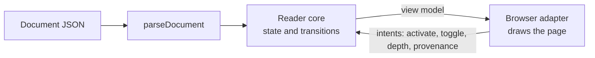

# Elastic Documents

A spike exploring **elastic documents**: text the reader stretches and shrinks in place. A summary opens into its detail, its sources, an example or its objections, then closes back again, and the reader stays oriented throughout.

This repository is an experimental reader for trying the ideas out. It is not a product, and it is not an Obsidian plugin.

## The idea

Ted Nelson described [stretchtext](https://xanadu.com/XUarchive/htn8.tif) in 1967: text that grows longer, with new details and clauses popping into place, and shrinks back on demand, while "the reader remains oriented". It never spread, because an author had to write every level of detail by hand.

A language model can now produce those levels. The open question is fidelity: can the reader always tell what the author said from what the AI added?

Stretchtext has relatives, and the spike borrows from them too:

| Idea | What the reader reveals |
|---|---|
| Stretchtext (Nelson, 1967) | More detail, in place |
| [Semantic zooming](https://www.cs.umd.edu/projects/hcil/pad%2B%2B/papers/jvlc-96-pad/zoom-6.html) (Pad++, 1996) | A different representation at each level |
| [View controls](https://doi.org/10.1145/1476589.1476645) (Engelbart, NLS, 1968) | Filtered and clipped views of one document |
| [Fisheye views](https://doi.org/10.1145/22627.22342) (Furnas, 1986) | Detail near the focus, landmarks further away |
| [Fluid documents](https://cdn.aaai.org/Symposia/Spring/2000/SS-00-04/SS00-04-028.pdf) (Xerox PARC, 2000) | Annotations that open between lines |
| [Transclusion](https://www.xanadu.com/xuvision.html) (Nelson, Xanadu) | The source passage itself |
| [Argument maps](https://doi.org/10.1145/58566.59297) (IBIS, gIBIS) | Why, objections, alternatives |

## Typed operations

One "more detail" control is not enough. A reader who does not understand a statement may need an example, not a longer statement. So a phrase can offer up to six operations, split by whether the result must come from the author or a source.

| Operation | Purpose | Must resolve to source? |
|---|---|---|
| Elaborate | Add detail | Yes |
| Ground | Reveal the sources | Yes |
| Derive | Show the intermediate steps | Yes |
| Exemplify | Make it concrete | No, marked as AI |
| Challenge | Show objections and limits | No, marked as AI |
| Reframe | Put it another way | No, marked as AI |

## Design principles under test

- **Compress, do not invent.** The detail comes from the author or the source; the AI produces the shorter levels. Compression can be checked against what it compresses. Generated detail cannot.
- **Provenance is visible at every level.** The author's words, an AI compression of them and an AI addition look different.
- **Expansions are stable.** Reopening an expansion shows the same content unless the reader asks for regeneration.
- **Measure comprehension, not satisfaction.** The test is whether a reader can explain the material back, not whether they felt they understood it.

The questions the spike should help answer:

1. Do readers given the six operations understand a document better than readers given one "more detail" control?
2. Are levels made by compressing a detailed source more faithful than levels made by expanding a terse one?
3. Does an elastic view of an agent-built change (intent, contract, change, diff) build more understanding than reading the diff alone?
4. Do readers catch an error planted in AI-generated text more often when provenance is marked?

## What the reader does so far

- **Expand and collapse in place.** Click a dotted phrase, or focus it and press Enter or Space.
- **Typed operations.** A phrase with one operation opens it straight away. A phrase with several shows a button for each, with a count of items. Elaborate replaces the phrase in place; the other operations open beneath its paragraph, each with a close control. Clicking a phrase with anything open closes it all.
- **Quiet buttons.** An elaborated phrase shows its buttons only while the pointer is over it or focus is inside it, and not in a phrase opened inside it. On a touch screen, tap its text. Pressed buttons for content open beneath stay, so the reader can see what is open. Hidden buttons stay in the tab order with their names.
- **Depth control.** A row of buttons beneath the title opens the whole document to a depth, a cheap form of semantic zooming (Engelbart's level clipping). Depth 0 shows the short forms; depth N opens every Elaborate from level 1 down to N. Levels start again at 1 inside content opened beneath a phrase. Choosing a depth resets whatever the reader opened or closed by hand. A depth is pressed only while every Elaborate is open exactly to it, counting those inside closed content, so no depth is pressed once the page has drifted.
- **Provenance marking.** Every paragraph, short form and long form is approved (written or approved by the author), an AI compression of approved text, or an AI addition. The author's words keep the body face. AI text takes a sans face and its own colour: upright for a compression, italic for an addition. A mark (✓, ≈ or ✦), which screen readers announce, names the provenance at the start of each level that differs from the text around it. Nothing marks where the text returns to the provenance around it, though the face and colour change back. A legend beside the Provenance switch explains the marks, and the switch hides them all.
- **Keyboard and screen reader support.** Every control is focusable, focus follows what opens and closes, and controls name what they reveal.

It currently shows a hand-written sample, [`examples/sample.json`](examples/sample.json).

## Where the documents will come from

The plan is to build elastic documents from an Obsidian vault. Every shorter level is a generated artefact that records the passages it came from, so *compress, do not invent* becomes the direction the build runs and stable expansions become a cache. Vault text counts as approved by its owner; only the build's output is marked as generated. See [ADR 0001](docs/adr/0001-build-elastic-documents-from-the-vault.md).

## Running it

```sh
npm install
npm run dev     # the reader, at the URL Vite prints
npm test        # Vitest
npm run build   # a static build in dist/
npm run export -- examples/sample.json   # one HTML file in exports/
```

The export writes a document and the reader into a single HTML file that opens from disk, offline, with nothing to fetch, so a study reader needs only the file. It checks the document first and reports every error with its path. Give a second path to write somewhere else: `npm run export -- doc.json out.html`. The dev server and `npm run build` show [`examples/sample.json`](examples/sample.json), which `package.json` maps to `#document`.

## Document format

A document is JSON. In a block, a string is text and an object is a stretch: a phrase with a short form and the content each operation reveals.

```json
{
  "title": "Elastic Documents",
  "blocks": [
    [
      "The idea is ",
      {
        "id": "nelson",
        "short": "Ted Nelson's stretchtext",
        "elaborate": ["Ted Nelson's stretchtext, from his Hypertext Note 8 of 1967"],
        "ground": [{ "note": "Stretchtext", "date": "2026-10-19", "quote": "the reader remains oriented" }],
        "challenge": ["It never spread: an author had to write every level by hand."]
      },
      "."
    ]
  ]
}
```

- `elaborate` holds text and stretches, so stretches nest.
- `ground` holds quoted passages, each with a `note`, a `quote` and an optional `date`.
- `derive`, `exemplify`, `challenge` and `reframe` hold paragraphs. A string stands for a paragraph of plain text; an array holds text and stretches.
- Every stretch needs a unique `id` without spaces, a non-blank `short` and at least one operation. The parser reports every error with its path.

### Provenance

A paragraph, short form or long form can be marked with where it came from: `approved`, `compression` or `addition`. A marked paragraph or long form is written `{ "provenance": ..., "inlines": [...] }`, and a marked short form `{ "provenance": ..., "text": "..." }`.

```json
{
  "provenance": "compression",
  "inlines": [
    "The idea is ",
    {
      "id": "nelson",
      "short": "Ted Nelson's stretchtext",
      "elaborate": {
        "provenance": "approved",
        "inlines": ["Ted Nelson's stretchtext, from his Hypertext Note 8 of 1967"]
      }
    },
    "."
  ]
}
```

- An unmarked level takes the provenance of the level around it, and the top level is approved. So this short form is a compression, like its paragraph. A long form takes the provenance of the text around its phrase, not of its short form.
- A mark the build forgets inside a compressed level leaves the text marked as AI text, not as approved. A forgotten mark on a top-level paragraph does show as approved, so the build must mark every paragraph it writes.
- Exemplify, Challenge and Reframe content is an addition, and so is every level inside an addition; any other mark there is an error. Ground quotes are always approved and take no mark.

## How the code is arranged

The logic lives in a tested core with no DOM. The browser code draws what the core says and forwards the reader's clicks and keys to it as intents.



- `src/core/document.ts` parses and validates documents.
- `src/core/state.ts` and `src/core/reader.ts` hold what is open and decide what each intent does, including where focus goes.
- `src/core/view.ts` turns the document and state into what the reader sees, including where provenance changes.
- `src/browser/render.ts` draws the view and handles clicks and keys.
- `src/export/build.ts` builds the reader with a given document in place of the sample, and `src/export/inline.ts` writes the script and stylesheet into the page. `scripts/export.ts` is the command.

## Next ideas

- **View filters**: "show only the assumptions" or "show only what the author said".
- **Fisheye prerequisites**: opening a claim also brings in the claims it depends on.
- **Orientation**: an outline, and the open state in the URL.
- **Study conditions**: six operations against one, provenance shown or hidden, and a downloadable event log.
- **A first real document** built from a vault note, with an error planted in generated text.

## Licence

[MIT](LICENSE)
